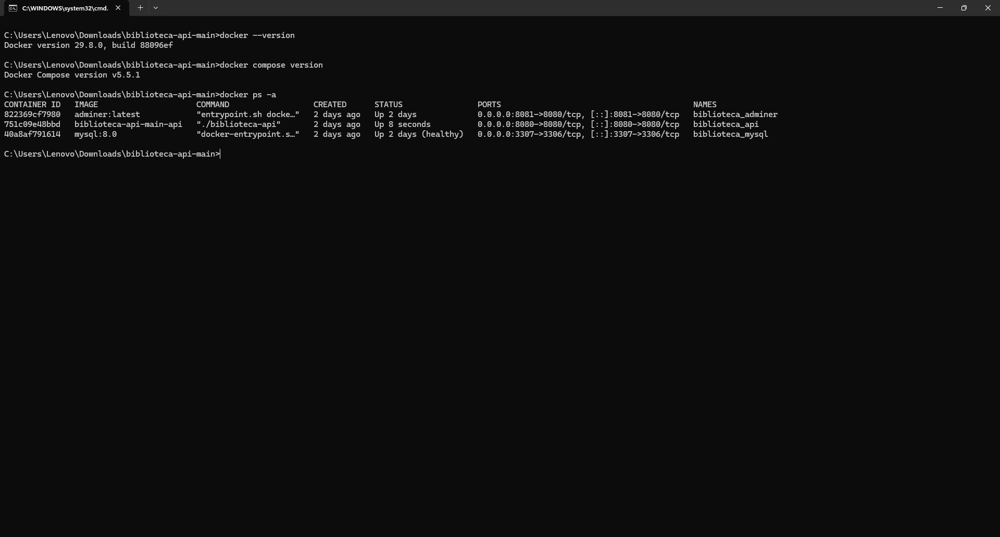
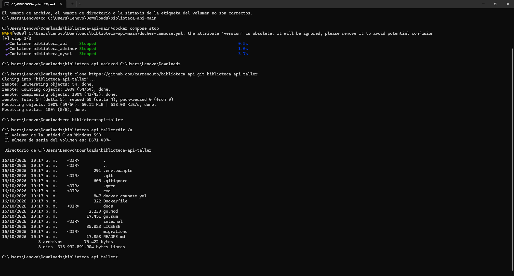
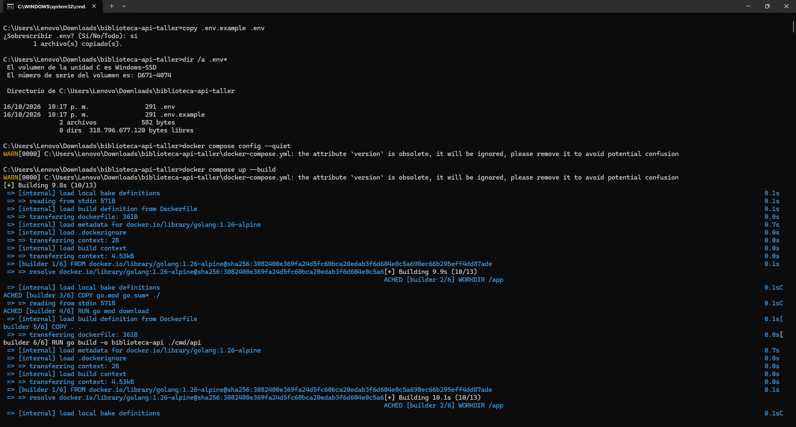
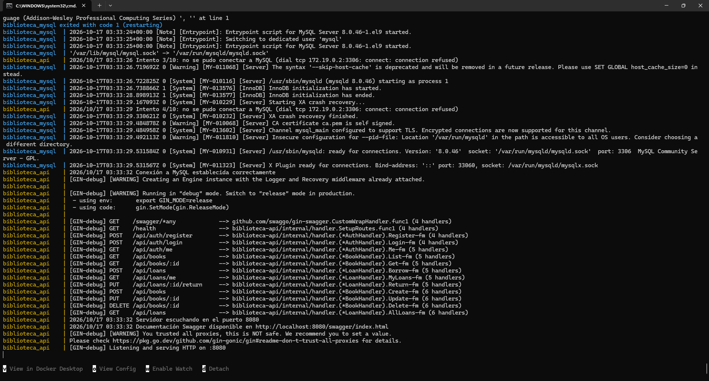
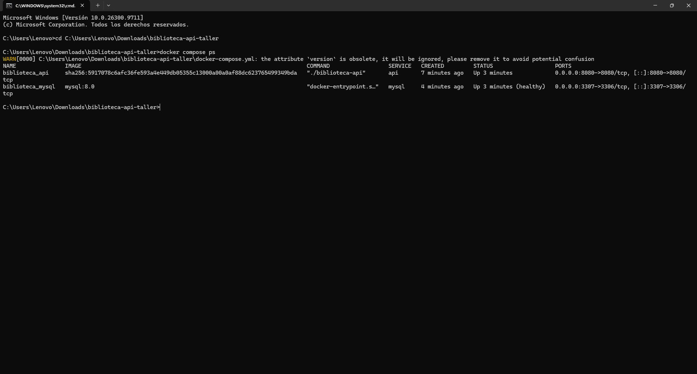
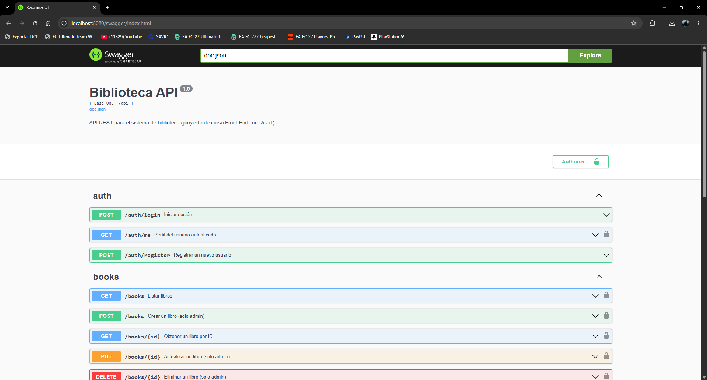
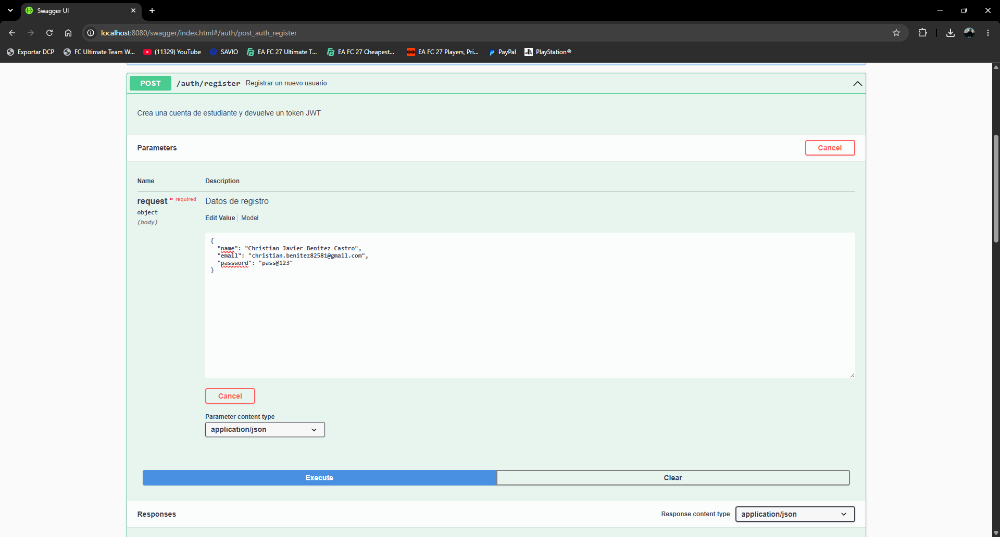
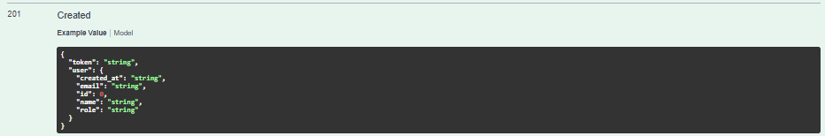
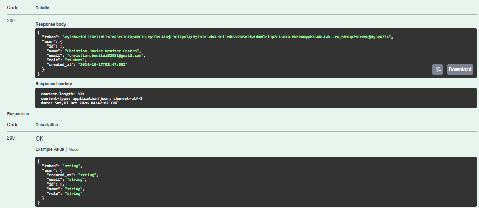
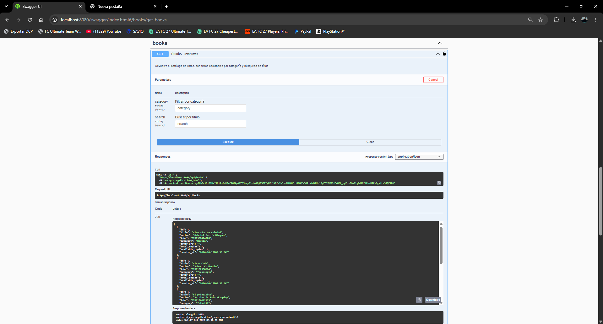

# Taller del segundo corte: Docker — Informe de práctica (Parte 2)

**Arquitectura de Software**  
**Estudiante:** Christian Javier Benitez Castro - T00082581  
**Docente:** Luis Giovanny Carreño Ortiz  
**Universidad Tecnológica de Bolívar — Cartagena de Indias**  
**Fecha:** 16/10/2026

## Introducción

En esta práctica ejecuté el proyecto **biblioteca-api**, una API REST en Go con una base de datos MySQL, usando Docker Compose desde CMD en Windows. Seguí las secciones 0 a 3 del README proporcionado por el profesor, documenté la ejecución y realicé el flujo de autenticación y consulta de libros en Swagger.

## 1. Preparación

Comprobé Docker 29.8.0 y Docker Compose v5.5.1 mediante `docker --version` y `docker compose version`. Después revisé los contenedores con `docker ps -a`, detuve los servicios anteriores con `docker compose stop` y cloné el proyecto desde GitHub:

```cmd
git clone https://github.com/carrenoutb/biblioteca-api.git biblioteca-api-taller
cd biblioteca-api-taller
dir /a
```

El repositorio incluye `Dockerfile` (construcción de la imagen Go), `docker-compose.yml` (coordinación de MySQL y API), `.env.example` (plantilla de configuración), `migrations/` (esquema y datos SQL) y `docs/` (Swagger). Git permite clonar el proyecto; Docker Desktop y el entorno Linux de WSL 2 son herramientas habituales para ejecutar contenedores Linux en Windows. No hay evidencia de que WSL 2 o Git se hayan instalado nuevamente durante esta práctica.




## 2. Configuración y puesta en marcha

Creé el archivo `.env` a partir de `.env.example` (sobrescribiendo una copia previa) y validé Compose:

```cmd
copy .env.example .env
dir /a .env*
docker compose config --quiet
docker compose up --build
```

| Variable | Función |
|---|---|
| `DB_HOST` | Nombre del servicio MySQL en la red Docker: `mysql`. |
| `DB_PORT` | Puerto interno de MySQL: `3306`. |
| `DB_USER` | Usuario para acceder a la base de datos. |
| `DB_PASSWORD` | Contraseña del usuario de MySQL para la API. |
| `DB_NAME` | Nombre de la base de datos. |
| `JWT_SECRET` | Secreto con el que se firman los tokens. |
| `JWT_EXPIRATION_HOURS` | Duración del token en horas. |
| `APP_PORT` | Puerto de escucha HTTP de la API. |

El primer arranque construyó la API, pero falló al publicar el puerto 3306 de MySQL, porque estaba ocupado en Windows. Cambié `3306:3306` por `3307:3306` en `docker-compose.yml` y repetí `docker compose up --build`. La aplicación informó que se había conectado a MySQL y que escuchaba en el puerto 8080.




## 3. Verificación

`docker compose ps` mostró `biblioteca_api` activo en 8080 y `biblioteca_mysql` **Up (healthy)**, publicado en `3307:3306`. Ingresé a `http://localhost:8080/swagger/index.html`, donde pude visualizar las rutas del proyecto.




Probé el flujo `POST /api/auth/register` (resultado 201), `POST /api/auth/login` (resultado 200) y `GET /api/books` (resultado 200 con un catálogo de libros). Las capturas del registro y login muestran los campos completos. Se adjunta además la respuesta real HTTP 200 del login. La captura 201 muestra el **Example Value** de la documentación de Swagger y no la respuesta real de registro; este último resultado fue observado durante la práctica, pero no quedó documentado directamente en la captura disponible. Todas las capturas se conservan a color, con sus datos visibles.



**Ejemplo de respuesta 201 en Swagger (documentación):**




**Respuesta real HTTP 200 del login:**




## 4. Problemas y soluciones

**Puerto 3306 ocupado (problema real):** Docker no podía publicar el puerto de MySQL; se corrigió cambiando el puerto externo a 3307. El puerto entre la API y MySQL continúa siendo 3306.

**Disponibilidad de Git (preparación):** existió inicialmente la duda de si CMD reconocía Git. Si el comando `git --version` no funciona, se instala Git for Windows y se abre otra consola. En la práctica el clonado fue exitoso, por lo que no se afirma un error confirmado en la captura.

**WSL 2 (requisito potencial):** Docker Desktop puede utilizar WSL 2 para contenedores Linux. Si falla el arranque del motor, se comprueban `wsl --version` y `wsl --status`. No hay evidencia de un fallo de WSL 2 en esta ejecución.

**Aviso sobre `version` (advertencia real):** Docker Compose ignoró el atributo `version`, actualmente obsoleto. Puede quitarse sin cambiar el resultado.

**Falta de `.env` (problema posible):** si no existe y está referenciado en Compose, la ejecución falla. Se soluciona copiando `.env.example` a `.env`.

## 5. Preguntas de comprensión

**1. Diferencia entre imagen y contenedor.** Una imagen es una plantilla con los elementos para ejecutar un programa; un contenedor es una instancia que se crea a partir de esa imagen. Por ejemplo, `mysql:8.0` es la imagen y `biblioteca_mysql` el contenedor que almacena los datos del proyecto.

**2. ¿Qué aporta Docker Compose frente a docker run?** Permite definir y levantar varios servicios coordinados, con sus redes, volúmenes, variables, puertos y dependencias, mediante un solo archivo y comando. Con `docker run` habría que configurar cada servicio por separado.

**3. ¿Por qué DB_HOST=mysql y no 127.0.0.1?** Porque Docker Compose permite que los contenedores se encuentren por el nombre del servicio en la red compartida. Para la API, `127.0.0.1` sería su propio contenedor y no el de la base de datos.

**4. ¿Qué borra docker compose down -v?** Detiene y elimina contenedores y red del proyecto y, con `-v`, elimina los volúmenes de Docker asociados; esto borra datos persistentes de MySQL. Se usa solo cuando se busca reinicializar la base y se acepta perder esos datos.

**5. ¿Qué ocurre al cambiar DB_PASSWORD en .env o MYSQL_PASSWORD en Compose, pero no ambos?** Las credenciales pueden quedar desincronizadas y la API no podrá iniciar sesión en MySQL. En una base ya inicializada, cambiar MYSQL_PASSWORD en Compose tampoco actualiza por sí solo la contraseña guardada en MySQL: se debe modificar allí y sincronizar la configuración de la API.

## Conclusión

Con esta práctica comprendí mejor la diferencia entre construir imágenes y ejecutar contenedores. Docker Compose me permitió administrar la API y MySQL con una configuración compartida. Aprendí que los puertos publicados en Windows no necesariamente son los mismos que se usan dentro de la red de Docker, y comprobé los resultados por medio de Swagger y consultas autenticadas.

## Fuentes

- Carreño, L. G. (2026). *Taller del 2do corte — Docker*. Material de Arquitectura de Software.
- [README.md del repositorio biblioteca-api](https://github.com/carrenoutb/biblioteca-api)
- [Documentación de Docker Compose](https://docs.docker.com/compose/)
